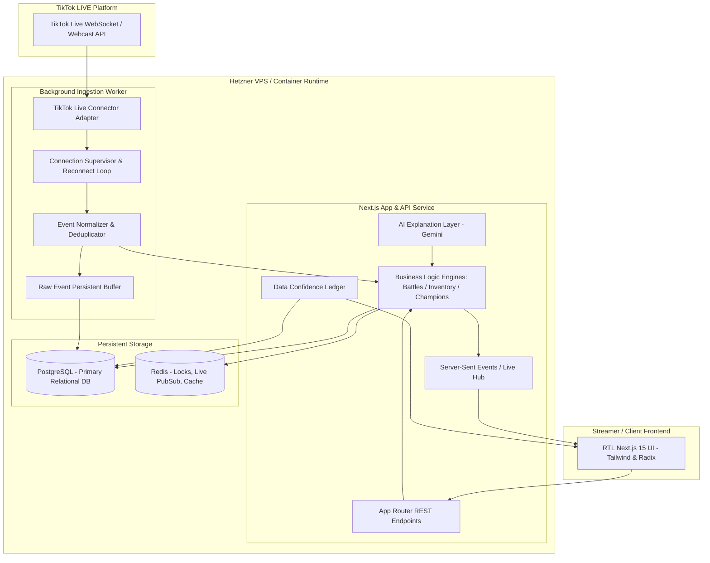

# LIVEPULSE INTELLIGENCE — بنية النظام والمعمارية (System Architecture)

## 1. النمط المعماري (Architectural Pattern)
النظام مبني على نمط **Modular Monolith** عالي الكفاءة، مع خدمات وعمال خلفيين (Background Ingestion Workers) مخصصة لاستقبال ومعالجة الأحداث الحية. هذا النمط يوفر:
- بساطة الصيانة والتشغيل على خادم واحد (Hetzner VPS < $7/mo).
- أداء فائق بزمن استجابة منخفض دون تعقيدات الـ Distributed Microservices.
- عزل منطقي كامل بين طبقات النظام (Domain Boundaries).

---

## 2. المكونات الأساسية وتدفق البيانات
1. **TikTok Live Connector Adapter:**
   - يغلف الاتصال بمكتبة موصل البثوث الحية.
   - يدير بروتوكول المصافحة، استخراج الـ room_id، واستقبال الأحداث الثنائية (Protobuf/JSON).
2. **Connection Supervisor:**
   - يراقب صحة الاتصال مع فترات فحص (Heartbeats).
   - ينفذ إعادة الاتصال التلقائي باستخدام Exponential Backoff مع Jitter عند الانقطاع أو إغلاق البث.
3. **Ingestion & Normalization Pipeline:**
   - استخراج مفتاح منع التكرار (`deduplicationKey`).
   - تحويل الأحداث إلى صيغة قياسية موحدة (`NormalizedEvent`).
   - حفظ الأحداث فوراً لمنع فقدان البيانات أثناء معالجة المنطق التجاري.
4. **Domain Engines:**
   - **Battle Engine:** مطابقة الفرق (1v1 و 2v2)، احتساب النقاط، وتسوية الفائز.
   - **Inventory Engine:** منح الأدوات (القفاز والضباب)، وإدارتها، وحساب الانتهاء الزمني خلال 5 أيام (120 ساعة).
   - **Champion Engine:** احتساب درجات الأبطال وفق معادلة متعددة الأوزان بعد تنقية التكرار والتطبيع.
   - **Enigma Engine:** مطابقة المعرفات وحساب درجات الثقة في تشابه الحسابات.
5. **Real-Time Delivery (SSE / WebSocket):**
   - بث التحديثات الفورية إلى واجهة المتصفح بشكل موجه لكل مستأجر (`tenantId`) دون تسريب البيانات.
