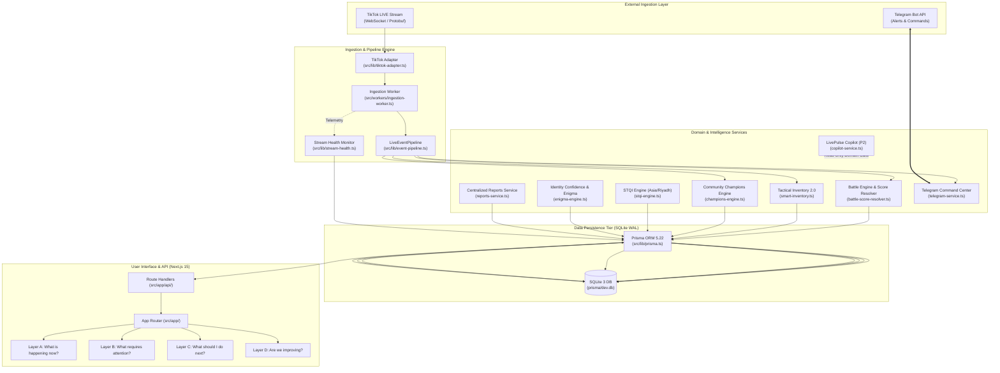

# LivePulse Intelligence — Architecture Audit & Flow Specification

**Date:** October 16, 2026  
**Project:** LivePulse Intelligence (`tik2026watchout`)

---

## 1. High-Level System Architecture

---

## 2. Ingestion Flow & Event Provenance

1. **Raw Event Arrival:**
   - Event arrives via `RealTikTokConnectorAdapter` (event types: `gift`, `chat`, `like`, `share`, `roomUser`, `linkMicBattle`, `linkMicArmies`).
   - Recorded into `RawEvent` table with unique `deduplicationKey` and `payload` JSON string.
2. **Event Normalization & Validation:**
   - Events are parsed and validated in `LiveEventPipeline`.
   - Events with missing critical fields are either enriched (e.g. supporter upsert) or safely rejected.
3. **Deterministic Idempotency Key Formulation:**
   - Format: `livepulse:{tenantId}:{battleOrSession}:{platformUserId}:{toolKey}:{upstreamEventId}`
   - If upstream event lacks reliable event ID, event is quarantined into `ExternalActivation` with `isQuarantined: true`, preventing unauthorized balance changes.
4. **Team Membership & Conflict Reconciliation:**
   - Reconciles `explicitTeam` against `BattleParticipant` and anchor platform identifiers.
   - Rejects opponent team (Team 2) supporters from receiving host tactical grants.
   - Rejects cross-tenant battles and conflicting team indicators.

---

## 3. Database Concurrency & Storage Model

- **Database Provider:** SQLite 3 with Write-Ahead Logging (`PRAGMA journal_mode=WAL`).
- **Synchronous Mode:** `NORMAL` for high throughput with data safety.
- **Busy Timeout:** 10,000ms configured on connections to prevent locked errors during concurrent read/write operations.
- **Process Boundaries:** Single Next.js application server process and one background Ingestion Worker process communicating through the shared SQLite WAL database file.
- **Transaction Safety:** Financial counters (diamonds, battle scores) and inventory updates are wrapped inside `prisma.$transaction`. Concurrency conflicts on unique constraints trigger Prisma `P2002` error handling.
