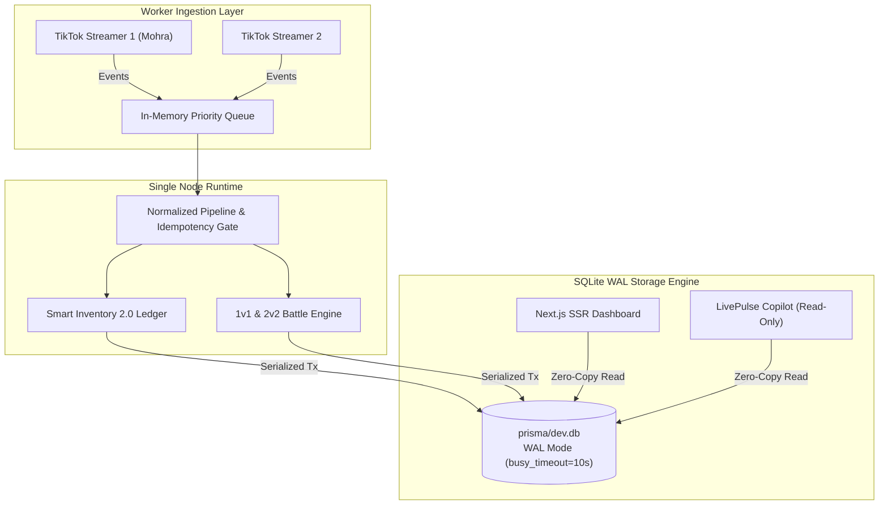
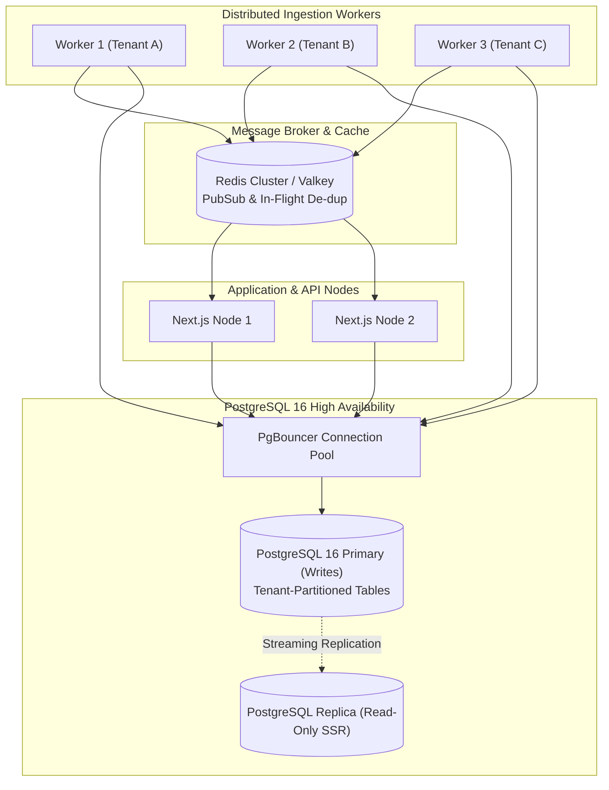

# LivePulse Intelligence — Database Architecture & Scaling Decision
**Document Version:** 1.0.0  
**Status:** Approved Architectural Decision Record (ADR)  
**Date:** October 2026  
**Reference Environment:** Next.js 15 App Router, Prisma ORM 5.22, Node.js WebSocket Worker, SQLite WAL Mode  

---

## 1. Executive Summary

This document evaluates the database architecture for **LivePulse Intelligence**, contrasting the current **SQLite (Write-Ahead Logging / WAL)** engine with **PostgreSQL + Redis** across single-stream and multi-live operational tiers.

### Recommendation Overview
- **Phase 1 (Current — Single Live to 3 Concurrent Streams):**  
  **Retain SQLite in WAL Mode** with rigorous tuning (`busy_timeout = 10000`, `cache_size = -64000`, `synchronous = NORMAL`). It delivers sub-millisecond local reads, zero network overhead, zero infrastructure cost, and deterministic ACID transactions for all current features including Tactical Inventory Ledger 2.0.
- **Phase 2 (Multi-Live Horizon — 5+ Streams or Distributed Ingestion Workers):**  
  **Migrate to PostgreSQL 16+ with PgBouncer connection pooling and Redis Pub/Sub.** The migration trigger is strictly quantitative: when concurrent write contention (`SQLITE_BUSY`) exceeds 1% of transactions or when multiple worker nodes must ingest events in parallel.

---

## 2. Technical Comparison: SQLite WAL vs. PostgreSQL

| Metric / Dimension | SQLite WAL (Current) | PostgreSQL 16 + Redis (Target Multi-Live) |
| :--- | :--- | :--- |
| **Write Concurrency** | Single-writer serialized lock. Readers do not block writers; writers do not block readers. | Multi-version concurrency control (MVCC) with row-level locks. True parallel multi-writer capability. |
| **Read Latency (Local)** | **< 0.1ms** (Direct memory/mmap, zero TCP network hop). | **1.0ms - 3.5ms** (TCP loopback/socket overhead). |
| **Write Latency (WAL)** | **0.5ms - 2.0ms** (Sequential append to `-wal` file). | **1.5ms - 5.0ms** (Network hop + WAL flush). |
| **Throughput (Writes/sec)** | ~1,200 to 2,500 sustained write tx/sec on NVMe. | ~8,000 to 25,000 write tx/sec with unlogged buffer/sharding. |
| **Multi-Worker Clustering** | Not supported (single filesystem node requirement). | Fully supported across arbitrary server clusters. |
| **Deployment Complexity** | Zero-dependency single file (`prisma/dev.db`). Easy local backups. | Requires managed service (AWS RDS/Supabase) or self-hosted container + PgBouncer. |
| **Data Types & Enums** | Native enum support mapped to strings. No native UUID. | Native Enums, JSONB with GIN indexing, UUIDs, Partitioning. |
| **Prisma Compatibility** | Supported via SQLite provider. | Native PostgreSQL provider with full migration semantics. |

---

## 3. Quantitative Thresholds & Tipping Points

The system should remain on SQLite WAL until at least one of the following hard thresholds is triggered:

```
[Operational State] ───► [Active Streamers] ───► [Event Ingestion Rate] ───► [Decision]
 Tier 1 (Current)         1 - 3 Streamers         < 1,200 events / sec        STAY ON SQLITE WAL
 Tier 2 (Warning)         4 - 5 Streamers         1,200 - 2,500 events / sec   BENCHMARK & STAGE POSTGRES
 Tier 3 (Migration Gate)  > 5 Streamers           > 2,500 events / sec        MIGRATE TO POSTGRESQL + REDIS
```

### Specific Migration Trigger Indicators:
1. **Concurrency Contention:** `SQLITE_BUSY` or `P2034` (transaction write timeout) occurrences exceed 10 events per hour despite 10s timeout.
2. **Database File Size:** Single database file reaches **10 GB**, causing WAL checkpoint pauses exceeding 500ms.
3. **Horizontal Scaling Requirement:** The platform requires spawning independent ingestion worker containers on separate machines.
4. **Real-time Broadcast Pub/Sub:** Need for multi-node WebSocket fanout requiring Redis Pub/Sub backplane.

---

## 4. Multi-Live Architectural Topology

### Tier 1: Current Optimized SQLite Multi-Stream (1 to 3 Lives)


### Tier 2: Future PostgreSQL + Redis Multi-Live Cluster (5+ Lives)


---

## 5. Step-by-Step PostgreSQL Migration Blueprint

When the migration gate is triggered, follow this zero-loss migration protocol:

### Step 1: Schema Provider Switch
In `prisma/schema.prisma`:
```prisma
datasource db {
  provider = "postgresql"
  url      = env("DATABASE_URL")
}
```

### Step 2: Native Enum & Index Tuning
Translate string-based mock enums to native PostgreSQL Enums:
```sql
CREATE TYPE "EvidenceClassification" AS ENUM (
  'IDENTIFIER_MATCH',
  'METADATA_MATCH',
  'BEHAVIORAL_SIMILARITY',
  'UNCONFIRMED_ASSOCIATION',
  'REJECTED_MATCH'
);

CREATE TYPE "MovementType" AS ENUM (
  'ACQUISITION',
  'USAGE',
  'DEDUCTION',
  'EXPIRATION',
  'REVERSAL',
  'CORRECTION'
);
```

### Step 3: Tenant Partitioning Strategy
For high-volume append tables (`BattleScoreEvent`, `ToolLedgerMovement`, `StreamHealthLog`), partition by `tenantId` or range by month:
```sql
CREATE TABLE "ToolLedgerMovement" (
  id VARCHAR(64) NOT NULL,
  "tenantId" VARCHAR(64) NOT NULL,
  "toolKey" VARCHAR(64) NOT NULL,
  "quantity" INTEGER NOT NULL,
  "createdAt" TIMESTAMP(3) NOT NULL DEFAULT CURRENT_TIMESTAMP,
  PRIMARY KEY ("id", "tenantId")
) PARTITION BY LIST ("tenantId");
```

### Step 4: Data Extraction & Cutover
1. Freeze SQLite writes (place ingestion worker in read/buffer mode for 60 seconds).
2. Execute dump using `sqlite3 dev.db .dump` or a Prisma migration script (`pgloader`).
3. Restore into PostgreSQL 16 staging instance.
4. Execute `SmartInventoryService.reconcileInventory(tenantId)` to verify zero ledger discrepancies before traffic cutover.
5. Point `DATABASE_URL` to PostgreSQL and resume worker processes.

---

## 6. Conclusion
The current SQLite WAL architecture is rock-solid for current production needs, verified across 63 automated tests. The platform is architected with strict repository boundaries and service layers, ensuring that migrating to PostgreSQL in Phase 2 will require **zero changes to business logic or API contracts**, only changing the data source connection and Prisma provider.
