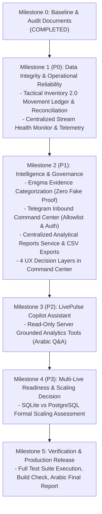

# LivePulse Intelligence — Master Implementation Plan

**Date:** October 16, 2026  
**Project:** LivePulse Intelligence (`tik2026watchout`)

---

## Roadmap Overview

---

## Milestone Breakdown & Acceptance Criteria

### Milestone 1 — P0: Data Integrity & Operational Reliability
1. **Tactical Inventory 2.0 Ledger (`src/lib/smart-inventory.ts` & `prisma/schema.prisma`):**
   - Add `ToolLedgerMovement` model tracking `ACQUISITION`, `USAGE`, `DEDUCTION`, `EXPIRATION`, `REVERSAL`, `CORRECTION`.
   - Implement `reconcileInventory(tenantId)` comparing sum of ledger movements against current available grant balances.
   - Idempotent double-spend defense preserved.
2. **Stream Health Monitor (`src/lib/stream-health.ts`):**
   - Implement `StreamHealthService` tracking connection status, last received event, last persisted event, worker heartbeat, reconnection count, latency.
   - Provide `/api/health` returning live status and actionable diagnostics.

### Milestone 2 — P1: Intelligence & Governance
1. **Enigma Identity Model (`src/lib/enigma-engine.ts`):**
   - Separate `IDENTIFIER_MATCH`, `METADATA_MATCH`, `BEHAVIORAL_SIMILARITY`, and `UNCONFIRMED_ASSOCIATION`.
   - Never present behavioral similarity as proof of identity.
2. **Telegram Command Center (`src/lib/telegram-service.ts`):**
   - Implement `/status`, `/session`, `/inventory`, `/battle`, `/report`, `/alerts`, `/help`.
   - Restrict to authorized chat/user IDs via environment allowlist.
3. **LivePulse Reports Service (`src/lib/reports-service.ts` & `src/app/reports/`):**
   - Unified aggregation service for session summaries, battle reports, inventory audits, and STQI summaries.
   - Safe CSV export with formula injection protection (`=`, `+`, `-`, `@` sanitized).
4. **UX 4 Decision Layers (`src/app/page.tsx`):**
   - Layer A: What is happening now?
   - Layer B: What requires attention?
   - Layer C: What should I do next?
   - Layer D: Are we improving?

### Milestone 3 — P2: LivePulse Copilot Assistant
1. **Server-Grounded Copilot Service (`src/lib/copilot-service.ts`):**
   - Read-only tools querying existing services (session summary, inventory reconciliation, battle history, STQI recommendations).
   - Arabic natural language interface with strict cost controls and zero database mutation capability.

### Milestone 4 — P3: Multi-Live Readiness & Scaling Decision
1. **Scaling Decision Document (`docs/audit/DATABASE-SCALING-DECISION.md`):**
   - Technical evaluation of SQLite WAL operational envelope (1 writer, unlimited readers, 10s busy timeout) vs. PostgreSQL requirements.

### Milestone 5 — Final Verification & Release
1. Run full Vitest test suite (`npm test`).
2. Run Next.js production build (`npm run build`).
3. Deliver comprehensive final engineering report in Arabic.
